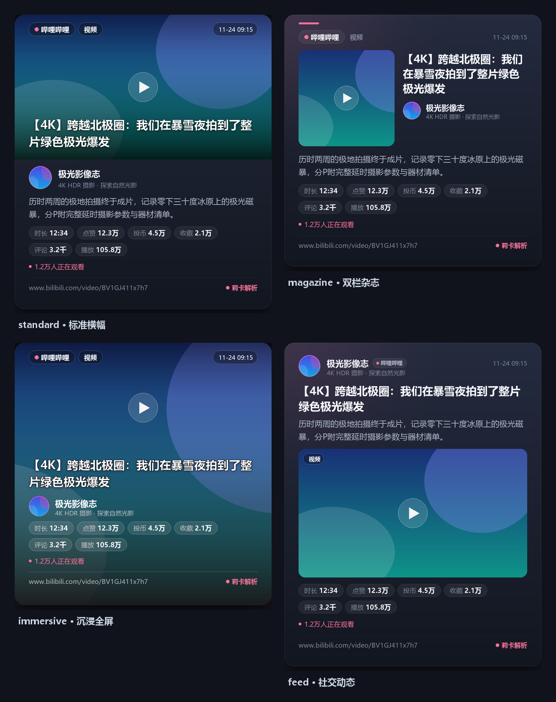
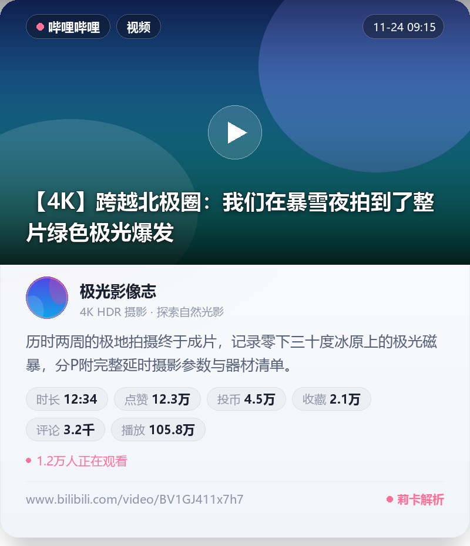

<div align="center">
  
  <h1>莉卡解析（astrbot_plugin_rika_share）</h1>
  <p>面向 <strong>AstrBot 4.x</strong> 的多平台链接与卡片分享自动解析插件</p>

  
  
  
</div>

---

自动识别聊天消息里的分享链接、群转发卡片与官方纯文本小程序卡片，提取正文、图集或音视频资源，并生成多种风格的 **Pillow 分享卡片** 发送至群聊或私聊。

## 效果预览



<details>
<summary>查看更多卡片样式示例（标准 / 双栏杂志 / 沉浸 / 社交动态）</summary>

- **浅色标准卡片**：
  
- 更多样式预览位于 [`docs/previews/`](docs/previews/)，也可随时在插件控制台切换 **4 种排版样式 × 深/浅配色** 实时生效。

</details>

---

## 核心功能

### 1. 内置支持 10 大平台 + 外部联动

| 平台 | 标识 | 支持内容 | 说明 |
| :--- | :--- | :--- | :--- |
| **哔哩哔哩** | `bilibili` | 视频、动态、图文 Opus、直播、专栏、收藏夹 | 内置 WebUI 与 `/bili_login` 扫码登录、状态监控与 Cookie 加密保存 |
| **抖音** | `douyin` | 无水印视频、图文动态、短链展开 | 支持实况照片与动图重建 |
| **快手** | `kuaishou` | 视频、图文 | 自动解析短链与直链 |
| **微博** | `weibo` | 动态、头条文章、视频 | 自动提取高清图集与正文 |
| **小红书** | `xiaohongshu` | 图文笔记、视频笔记 | 可在配置中填入 Cookie 提升稳定性 |
| **Twitter / X** | `twitter` | 推文、图片、视频、GIF | 支持填写自定义 Cloudflare Worker 反代 |
| **AcFun** | `acfun` | 视频与分 P 信息 | 原生播放与封面提取 |
| **NGA** | `nga` | 论坛主贴正文与附件图 | 清理论坛排版标签 |
| **GitHub** | `github` | 仓库主页卡片 | 提取 Star / Fork / Issues / 语言 / License / Topics |
| **酷安** | `coolapk` | 动态、图文卡片 | 社区动态与图文解析 |
| **网易云音乐（联动）** | `netease` | 歌曲、歌单、专辑、播客（需安装 `astrbot_plugin_multincm`） | 安装后自动接入，遵循音乐卡片 / 文件发送等联动设置 |

### 2. 特色能力

- **多种卡片排版与极速渲染**：内置 `standard`（标准横幅）、`magazine`（双栏杂志）、`immersive`（沉浸全屏）、`feed`（社交动态）4 种排版及深浅配色，支持自适应系统字体与颜文字回退；支持**自定义卡片署名**（关闭人格跟随时可自由修改默认 `莉卡解析`），并可选开启**随会话人格变更署名**（命中如「达妮娅」人格时卡片与消息头变为 `达妮娅解析`，并跨人格共享底卡缓存）。
- **分群独立配置（零重解析代价）**：支持在控制面板顶部切换配置作用域，按群号或 UMO 为不同群单独设置**启用平台、输出节点编排、卡片样式/尺寸/署名、非 OneBot 网页分享与错误提示**；账号凭据（B站/小红书 Cookie）、清晰度/编码、代理及 WebUI 布局主题统一全局生效，同一链接跨群仍可直接命中解析缓存。
- **分模式输出节点编排**：按 **视频模式 / 图文模式 / 动态·文章模式** 分别定制各输出节点的开关、发送顺序与是否放入合并转发——OneBot 协议下可将视频文件直接放入合并转发；外部网易云联动音乐卡片自动固定独立发送并在面板明示不支持合并转发。
- **QQ 小程序与图文卡片识别**：支持 OneBot 卡片 JSON 与官方机器人纯文本卡片（含无链接标题召回）。
- **非 OneBot 合并转发转网页**：在 QQ Official、Telegram、Discord 等不支持合并转发的平台中，自动将多条图集内容合成为临时网页链接（需在 AstrBot 填好 `callback_api_base`）。
- **未适配网页截图兜底**：可选接入 Cloudflare Browser Rendering API，为普通网页自动生成截图预览，支持域名/通配符黑名单与高级浏览器参数。

---

## 快速安装

1. 在 **AstrBot 控制台 → 插件市场** 搜索并安装 **`莉卡解析`**（或将本仓库克隆至 `data/plugins/astrbot_plugin_rika_share`）。
2. 如需手动安装依赖，可在 AstrBot 所在 Python 环境中执行：
   ```bash
   pip install -r requirements.txt
   ```
3. 重载或启动 AstrBot 后，打开 **插件 → 莉卡解析 → 控制面板**（或「查看插件页面」）即可图形化管理全部设置。

> 插件运行需要 **AstrBot `>= 4.0.0`**。

---

## 常用指令与用法

| 指令 / 触发方式 | 权限 | 说明 |
| :--- | :--- | :--- |
| 直接发送分享链接 / 卡片 | 所有人 | 自动识别所属平台并输出卡片或多媒体（可在面板逐个开关平台） |
| **引用**消息并回复 `下载封面` | 所有人 | 提取被引用消息里视频/图集的原封面图（亦认 `下载封面图`、`下载封面图片`、`/下载封面`） |
| `/bili_login` | 管理员 | 获取 B站扫码登录二维码，扫码后自动写入 Cookie 并开启失效监控 |
| `/bili_check` | 所有人 | 立即验证当前 B站 Cookie 是否有效并刷新用户名与 VIP 状态 |
| `/bili_status` | 所有人 | 查看 B站 Cookie 配置情况、监控状态与上次检测时间 |
| `/clear_cache`（别名：`清理缓存`） | 管理员 | 手动清理磁盘缓存、临时网页与内存索引 |

---

## 控制面板与布局级主题（WebUI）

插件面板位于 [`views/rika/`](views/rika/index.html)，顶部提供 **作用域切换条**（可随时在「全局默认」与任意群号 / UMO 之间切换、新建分群、恢复单项继承或清空该群覆写），下方按使用心智划分为 **4 大工作区**：

1. **总览与诊断**：查看当前作用域下的平台启停、B站登录态检测、缓存磁盘占用（安全行内清理），并可指定当前分群配置执行只读全链路诊断与脱敏 `.log` 下载。
2. **平台与账号**：支持按分群定制平台开关矩阵（全局共享 B站扫码登录态、Cookie 与清晰度/代理策略），同时展示画质、编码与 OneBot 合并转发分批上限。
3. **卡片工作室（所见即所得）**：左侧调整版式样式（自动向后端拉取含自定义样式在内的**真实样图**）、深浅配色、宽度滑块、封面全尺寸、字体、**随会话人格署名**开关及关闭后的**自定义署名**，并内嵌**输出节点编排器（视频 / 图文 / 动态·文章三模式独立开关、排序与合并控制）**；右侧**实时渲染真卡片大图**（支持视频 / 7 图集 / 无图转发样例切换与点击放大），下方收拢网页分发与缓存清理设置。
4. **主题与兜底**：切换不同空间架构的网页布局主题、管理 Cloudflare 未适配网页截图兜底（支持按分群覆盖兜底开关与域名黑名单，账号凭据与浏览器高级参数仅全局）与错误日志策略。

### 内置两套结构级网页主题 & 扩展接口

这里的主题不止换色，而是同步改变页面骨架、导航形态与容器景深：
- **`studio`（工作台分栏 · 默认）**：左侧固定秩序导航栏 + 右侧精密分栏工作区，清晰克制，适合高频精细调参。
- **`glass-center`（悬浮磨砂控制中心）**：隐藏侧边栏与传统后台顶栏，改用极光背景下的通透毛玻璃浮层与**底部居中悬浮胶囊 Dock** 导航。

可通过 [`views/rika/themes/`](views/rika/themes/) 新增主题模块并在 [`views/rika/themes/index.js`](views/rika/themes/index.js) 注册，或直接调用全局扩展接口 `window.RikaWebTheme.registerTheme(...)`：

```js
window.RikaWebTheme.registerTheme({
  id: "my-layout",
  name: "我的布局主题",
  layout: "my-layout",
  navMode: "dock", // "sidebar" 或 "dock"
  light: { "--accent": "#2563eb", "--bg": "#f5f8ff" },
  dark: { "--accent": "#60a5fa", "--bg": "#0f172a" },
  css: `[data-layout="my-layout"] .surface-panel { border-radius: 18px; }`,
});
```

---

## 常见问题（FAQ）

<details>
<summary>1. 为什么在 QQ Official / Telegram 上解析长图文变成了网页链接？</summary>

因为这些平台没有合并转发能力。插件会借助 AstrBot 内置文件服务生成临时浏览网页；请确认在 AstrBot 全局设置里正确填写了公网可达的 **`callback_api_base`**（QQ 官方图文卡片要求 `https://`），若不需要可到 **卡片工作室 → 非 OneBot 分发与缓存清理** 关闭。

</details>

<details>
<summary>2. B站视频画质最高只能选 360P / 480P 怎么办？</summary>

B站高画质与部分图文动态需要登录态。推荐直接打开 **控制面板 → 平台与账号 → 扫码登录 B站** 在网页端扫码（也可在聊天中发送 `/bili_login`），登录成功会自动加密持久化 Cookie 并支持在面板实时查看状态与手动检测。

</details>

<details>
<summary>3. Twitter / X 在境内无法访问怎么配置反代？</summary>

进入 **控制面板 → 平台与账号 → 画质、代理与发送策略**，开启 Twitter 反代开关并填写你的 Worker 地址即可。

</details>

<details>
<summary>4. 为什么我的插件原生设置页里几乎是空的？</summary>

自 3.x 起，为提供平台开关矩阵、实时卡片工作室与链接诊断功能，所有配置项统一收纳在 **插件专属 WebUI 面板（`views/rika`）** 维护，原设置 Schema 仅保留存储与 `secret: true` 脱敏契约。

</details>

<details>
<summary>5. 如何为指定群单独调整输出样式或节点顺序（含合并转发里的视频）？</summary>

打开 **插件控制面板** 顶部 **作用域** 下拉栏，选择活跃群组或点击 **`+ 添加分群`** 输入群号创建独立档案；切换后可在 **平台与账号 / 卡片工作室 / 主题与兜底** 中修改任意允许分群覆写的选项（不可分群项如 Cookie、画质、WebUI 主题会自动标注「仅全局」）。在 **卡片工作室 → 输出节点编排** 中可分别编辑「视频模式 / 图文模式 / 动态·文章模式」的节点开关、排序与「放入合并」——OneBot 下支持勾选「视频文件 → 放入合并」（推荐同时配置 AstrBot `callback_api_base` 以适配跨容器协议端）；外部音乐卡片因协议限制固定按序独立发送，不支持放入合并转发。

</details>

---

## 目录结构与开发文档

```text
astrbot_plugin_rika_share/
├── main.py                  # AstrBot 4.x 插件入口（Star + 事件 Handler）
├── metadata.yaml            # 插件元数据（astrbot_version >= 4.0.0）
├── logo.png                 # 插件图标
├── _conf_schema.json        # 存储 Schema 契约
├── .astrbot-plugin/i18n/    # 多语言文案
├── views/rika/              # 插件控制面板前端与 themes/ 主题包
├── link_parser/             # 核心包（adapters / config / models / output / services / utils / webui）
├── docs/                    # 架构备忘 docs/ARCHITECTURE.md 与卡片预览图
└── scripts/                 # 渲染回归与独立冒烟测试脚本
```

更多架构约定、扩展机制（新增平台 / 外部联动 / 新增卡片样式 / 新增网页主题）与历史变更请查阅：
- 开发者备忘与架构文档：[`docs/ARCHITECTURE.md`](docs/ARCHITECTURE.md)
- 完整变更日志：[`CHANGELOG.md`](CHANGELOG.md)

---

## 致谢与协议

- 核心解析移植并改进自 [nonebot-plugin-parser](https://github.com/fllesser/nonebot-plugin-parser)（[@fllesser](https://github.com/fllesser)）
- 网页控制台初版参考了 [astrbot_plugin_denia_share](https://github.com/xiaoxi2760/astrbot_plugin_denia_share)
- 非 OneBot 网页浏览页形态参考了 [qbob](https://github.com/Loping151/qbob)（页面代码已独立重写以遵守 MIT 协议）
- 网易云音乐联动感谢 [astrbot_plugin_multincm](https://github.com/iris1598/astrbot_plugin_multincm)

本项目以 [**MIT License**](LICENSE) 开源。
